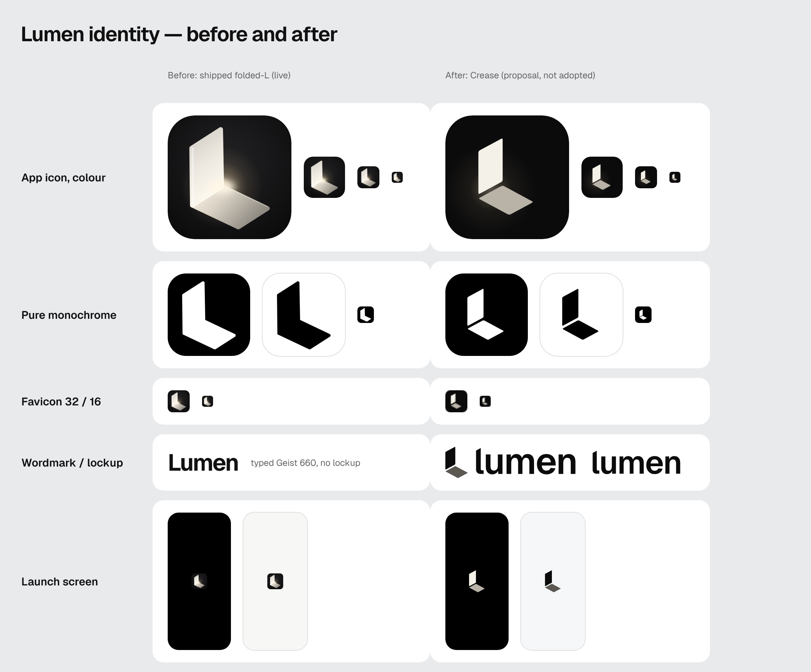

# Lumen identity proposal: **Crease**

**Status: proposal for owner review. Not adopted.** The live app still ships the folded-L (`public-canvas/`,
`scripts/canvas-icons.mjs`). Nothing in this folder is referenced by the app or the build. Adopting it needs the
owner's approval of the final identity, and then separate approval for the merge and the deploy.

## The idea in one line

A sheet of light folded into a standing page and a floor. The gap between the two planes is the **crease**: the
opening the light comes through.

"Lumen" means two things: the unit of light, and the open space inside something (the lumen of a tube). The crease
is both at once. It's also where the two planes meet, which is what Lumen does: you on one side, the models on the
other, one place where they meet.

## Brand personality

- **Quiet, exact, warm at the centre.** The interface is ink and paper. The only warmth in Lumen is its light: the
  colour icon's crease and, in the app, selected text (lamplight). Nothing else is coloured for decoration.
- **A tool for reading and writing, not a dashboard.** The mark is a page standing on a surface, not a circuit, a
  spark, a brain or a chat bubble.
- **Built, not rendered.** The mark is flat geometry that survives one colour, 16 pixels, embroidery, a stamp. Depth
  comes from two tones, not from gradients.

## What was wrong with the shipped folded-L

The folded-L is a good *picture*: a soft rendered panel with a glow where it folds. Its idea (light where a page
meets a surface) is worth keeping, and this proposal keeps it. As a *mark* it has five problems:

1. **It disappears in one colour.** Flattened (see "Pure monochrome" above), the two planes merge into a plain
   chunky L and the idea, the light at the fold, is gone. A mark that only works as a rendering can't be printed,
   stamped, embossed, used as a single-colour system icon, or drawn in a favicon.
2. **The meaning lives in the effects.** Gradients, a blurred glow and a screen-blended halo carry the idea. At
   32 px and below they turn into a grey smudge in the middle of the tile.
3. **Not reproducible as a clean master.** It needs filters and blend modes, so there's no plain vector to hand to
   anyone else, and different renderers draw it differently.
4. **Warm cream against a cool interface.** Its cream-and-amber light doesn't belong to the cool ink and paper of
   Canvas, and nothing else in the app relates to it.
5. **No wordmark.** "Lumen" is set live in Geist 660, with a capital L and no relationship to the symbol.

## The proposal

### Mark

Two planes in an axonometric view. The panel stands; the floor recedes toward the viewer; a constant gap separates
them. It is one idea with one silhouette, and the gap still reads when the mark is a single colour.

Construction, on its own grid (`scripts/brand-crease.mjs`, `MARK`):

| Parameter | Value | What it does |
|---|---|---|
| `W` panel width | 132 | width of the standing page |
| `D` floor depth | 168 | how far the floor reaches toward you |
| `H` panel height | 236 | height of the page above the crease |
| `S` slope | 0.54 | both receding edges (about 28°); the wordmark's l is cut at the same angle |
| `G` crease | 22 | the opening; 40 in the small-size drawing |
| `R` corners | 10 | soft corners, quadratic joins; 6 in the small-size drawing |

Optical adjustments: in the tile the mark sits 6 units left and 4 up of geometric centre (the floor's long point pulls
the eye right and down), and it takes 62% of the tile's height. The maskable icon uses 48%, inside the 80% safe
zone. Small sizes (favicon) use a separate drawing with a wider crease, so the gap survives the pixel grid at 16 px.

### Wordmark

"lumen", lowercase, set in **Geist 600** (the interface typeface, so brand and product speak with one voice),
tracked −30/1000, outlined to paths. The one custom letter is the **l**: its top is cut at the mark's 28° slope, so
the first letter is a small standing panel with Geist's own foot. Lowercase reads as a calm noun rather than a
shouted brand.

### Colour

| Token | Value | Use |
|---|---|---|
| Ink | `#0b0b0c` | tile, wordmark on light, mono |
| Paper | `#f5f4f0` | wordmark on dark, light tile |
| Lit | `#f4f1e8` | the standing plane in colour |
| Shade | `#b9b3a7` on dark, `#5b5852` on light | the floor plane in colour |
| Lamplight | `#f1e2b6` / `#4d4130` | the only warm interface colour: text selection (implemented) |

The colour icon adds one soft warm halo centred on the crease: the light coming through the opening. It's the only
gradient in the identity, and it carries the idea instead of decorating it. The mono icons have none.

### Usage rules

- **Clear space:** the crease gap × 4 on every side of the mark; the l's height on every side of the lockup.
- **Minimum size:** mark 16 px (use `favicon.svg` geometry below 48 px); wordmark 14 px tall; lockup 20 px tall.
- **Lockup:** the mark sits on the baseline with its floor tip just below it, 1.22× the l's height. Inside the app
  the wordmark alone is usually enough (the icon is already on the home screen); use the lockup where the mark isn't
  otherwise visible (sign-in, shared pages, the drawer head).
- **Never** recolour the two planes in different hues, outline the mark, add a drop shadow, rotate it, or close the
  crease.

## Files

All generated by `node scripts/brand-crease.mjs` (needs Playwright's Chromium, already a dev dependency). The
wordmark's outlines come from `source/geist-600.json`, extracted from Geist (SIL Open Font License 1.1) by
`python3 scripts/brand-crease-glyphs.py` (needs `fonttools` and `brotli`; only to change the weight or letters).

| Folder | Contents |
|---|---|
| `svg/` | `mark` (colour on dark), `mark-on-light`, `mark-mono` (currentColor), `mark-black`, `mark-white`; `wordmark-ink/-paper/-mono`; `lockup-on-light/-on-dark/-mono`; `app-icon-dark/-light/-mono/-mono-light`; `favicon` |
| `png/` | `apple-touch-icon` 180 (square, iOS masks it), `icon-192`, `icon-512`, `icon-maskable-512`, `favicon-32`, `favicon-16` |
| `splash/` | 22 iOS launch screens, light and dark, same names and sizes as `public/splash/` |
| `manifest.webmanifest` | the Canvas manifest with the same colours |
| `mockups/` | before/after board, desktop browser (light, dark), iPhone home screen and drawer, launch screens |

Mockups of the app are real Canvas screenshots (synthetic account, no network) with the proposed lockup swapped into
the sidebar in the browser; no app code changed.

## Practical similarity review (not trademark clearance)

A short search and a visual comparison, not a legal search. Before adoption the owner may want a professional
clearance check in the relevant classes and markets.

- **Name, wordmark:** *Lumen* is a crowded name. The largest user is Lumen Technologies (telecom), whose logo is a
  cyan, lowercase sans-serif wordmark (per a third-party logo index, not the company's own brand pages). A
  lowercase "lumen" in a sans is therefore not distinctive on its own. Here the distinction has to come from the
  symbol, the slanted l and the monochrome palette. This is the main risk, and it's a risk of the name more than
  of this design; the shipped "Lumen" wordmark has it too.
- **Symbol:** isometric and "stencil" letter-L devices are common in stock logo marketplaces. No named brand with
  this exact form (a standing plane and a receding floor separated by a constant gap) turned up, but a cursory
  search can't rule it out. The crease and the 28° geometry are what make it ownable; keep them exact.
- **Avoided on purpose:** sparkles, stars, brains, chat bubbles, light bulbs, gradients as decoration, and
  anything resembling other AI products' marks.

Sources: [logotyp.us — Lumen](https://logotyp.us/logo/lumen/), general web search for isometric/folded L marks
(2026-10-23).

## What adoption would change (not done)

1. Copy `png/`, `splash/`, `svg/app-icon-dark.svg` (as `icon.svg`) and `manifest.webmanifest` into `public-canvas/`,
   and replace `scripts/canvas-icons.mjs` with this generator writing there.
2. `src/components/Logo.tsx` (Canvas branch) and the sidebar head (`SidebarCanvas.tsx`, `.cv-wordmark`) use the
   inline lockup or wordmark SVG instead of the typed "Lumen".
3. Update `DESIGN.md` (Mark), the QA contracts that look for the icon, and the launch-screen links if sizes change.
4. Physical iPhone check: home-screen icon, launch screen in light and dark, PWA install.
