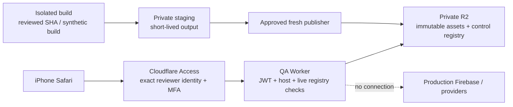

# Reusable private iPhone Safari QA — decision proposal

**21 October 2026 · planning/documentation ONLY · QA00 · source inspected: `c9153fd75ba16ebf70908f5d8c092cb540b9aa58` · draft [PR #34](https://github.com/Seifonyx/Lumen/pull/34).**

The owner commissioned a reusable private testing capability, rather than a permanently public preview. This document records that requirement as an execution-policy amendment alongside the preserved [Blackout master](MASTER_REQUIREMENTS.md), [Canvas blueprint](CANVAS_PRODUCTION_INTEGRATION_BLUEPRINT.md) and [CP01 report](CP01_FOUNDATION.md). It authorizes **no implementation, infrastructure, service enrollment, spending, exposure or deployment**. Gate 1 is approved; Gates 2/3 remain pending. CP02 is separately unauthorized. Blackout v1 stays **21.5% → 21.5%, Medium confidence**, 78.5 points remaining; QA preparation earns no new weighted credit.

## Recommendation and decision

Use **Cloudflare Access → one dedicated QA Worker → private R2 serving storage**, with a stable protected entry and immutable, expiring build paths. Reuse GitHub Actions for repeatable validation/publication after separate tooling authorization, with a second private, short-lived staging bucket for its build handoff. Keep the existing production Firebase hosting, provider relay and localhost proof unchanged.

Start with an **Access-protected dedicated `workers.dev` hostname**, requiring no domain purchase or DNS migration. Current Cloudflare documentation explicitly supports Access on a Worker's main `workers.dev` URL [S1]. This is an Internet-reachable authentication gateway, **not a private network**; app content is private behind access control. A dedicated custom hostname can replace it later if the owner already controls a suitable zone and approves that configuration. Cloudflare recommends custom domains/routes for business-critical services; a noncritical synthetic owner QA service can initially accept the documented `workers.dev` limitations. Never reuse the provider relay's hostname or broaden its CORS/permissions.

The stable address opens a private build list. Choosing a build opens `/b/<full-sha>-<run-id>-<attempt>/`, pinned for that review; no automatic switch to a newer build. Retain at most **3 active builds**, **72-hour access per build**, and an **8-hour login/MFA session** as proposed defaults. Expiry is enforced on requests even if cleanup jobs fail. These values require owner acceptance, not assumed consent.

This uses one small gate rather than a gateway platform or a second application backend. R2 supplies assets and a strongly consistent control record, so there is no separate database, Durable Object or eventually consistent KV revocation list. Cloudflare documents both R2 strong consistency and conditional writes [S5]. No hosted code, account settings or vendor-plan eligibility was tested in this session; this remains a conditional recommendation until QA01/QA02 acceptance passes.

## Existing infrastructure and concrete gaps

Repository evidence was read at the source SHA above; the three live continuity files were recovered from `docs/lumen-live-context` at `f26f835e19be3aad266e8161b78711ad6906cfa9`. Worktree clean, workstream local/remote equal, PR34 open/draft/unmerged. No inaccessible Claude WIP is assumed recovered; unrelated worktrees were preserved.

| Existing owner / file | Inspected behavior | Consequence for this proposal |
|---|---|---|
| [Preview workflow](../../.github/workflows/preview.yml), [deploy workflow](../../.github/workflows/deploy.yml), [hosting config](../../firebase.json), [project association](../../.firebaserc) | Manual dispatch; ordinary Vite build; Firebase preview `dev`, 30 days, old hosting site in the same Firebase project as production. Deploy workflow also deploys live. | Do not invoke or repurpose them. Firebase explicitly calls hashed preview URLs **public** [S8]. A separate hosting site is not a separate Firebase backend/security boundary [S9]. |
| [Relay workflow](../../.github/workflows/relay-deploy.yml), [relay config](../../server/provider-relay/wrangler.jsonc), [relay documentation](../../server/provider-relay/README.md) | Cloudflare Worker tooling already exists; relay is BYOK with upstream forwarding, not reviewer authentication. | Prefer the familiar vendor; create separately scoped QA resources only after approval. Existing secret names/documented deployment do not prove current dashboard rights, Access/R2 enrollment, budget or domain ownership. No secret values were accessed. |
| [Tests workflow](../../.github/workflows/tests.yml), [package scripts](../../package.json) | Node22, existing Chromium/WebKit, unit/build and Firebase-emulator infrastructure; Markdown/docs path exclusions. | Reuse the harness and fixtures. Keep emulator testing local/CI; do not host emulators for phones. A stale private-repository comment in this workflow is not authority: the repository is public. |
| [Proof bootstrap](workspace-proofs/bootstrap.ts) | Hostname must be `localhost`; synthetic account checks; fetch/XHR interception; explicit local Playwright capability. Imports the real proof only after checks. | Preserve these bytes/negative tests. Do not add a remote hostname, accept a URL token, spoof localhost or expose Vite. The local fetch patch is insufficient as an Internet-preview security boundary. |
| [Firebase module](../../src/lib/firebase.ts), [sync](../../src/lib/sync.ts), [store](../../src/store.ts) | Firebase initializes on import; synthetic guest support still shares that module; sync imports Firestore. | A seeded guest is **not** proof of no Firebase traffic. A separate compile-time QA target must exclude real Firebase initialization/config/sync and live authentication, not merely avoid the sign-in button. |
| [Vite configuration](../../vite.config.ts), [SW registration](../../src/pwa/register.ts), [SW source](../../src/pwa/sw.js) | Production emits/registers an offline service worker with root-scoped precaching. | A QA-specific build must emit/register **no service worker**, manifest installation flow or offline app shell. Never reuse production assets' public/immutable HTTP caching policy for private QA delivery. |

CP01 already proved the ordinary build excludes proof/test imports and its emitted assets were unchanged. Its exact-head [CI run 39631070563](https://github.com/Seifonyx/Lumen/actions/runs/39631070563) was freshly queried: all three jobs succeeded at `c9153fd…`. That is existing foundation evidence, **not evidence that this new system works**.

## Realistic alternatives

| Option | Safari/access/isolation feasibility | Cost and operational tradeoff | Decision |
|---|---|---|---|
| **Access + dedicated Worker + private R2** | Clientless Safari auth; protect HTML **and every asset**; one immutable build store with per-request expiry/revocation. Synthetic app target still needed. | Existing vendor/tooling, small gate plus storage; Access/R2 eligibility and billing activation need confirmation. No VM/tunnel. | **Recommended**, conditional on account and isolation checks. |
| **Cloudflare Pages + Access** | Real supported preview protection. Documentation warns the preview toggle does **not** protect the main `pages.dev`/custom domain; all aliases must be addressed [S10]. | Simpler initial static publish, but authenticated expiry, stale aliases and immediate build revocation still need middleware/control logic or careful deletion. | Viable runner-up; less compelling once exact lifetime and reusable stable access are included. No claim Pages cannot be secured. |
| **Separate Google Cloud project + Cloud Run + IAP** | Browser login and IAM restriction; current docs support direct IAP across `run.app` and load-balancer paths [S11]. Do not require a load balancer unnecessarily. | New QA project/service, IAM/OAuth/billing and container upkeep; avoids app Firebase data but more infrastructure than a synthetic static review needs. Eligibility/cost unverified. | Viable if the owner prefers Google-only hosting; not the lowest-maintenance default here. |
| **Private VPN/overlay + isolated local host** | Can work with an installed iPhone VPN client and authorized remote host. Safari itself cannot reach this machine's localhost. | Host uptime, client setup, TLS/private DNS, origin adaptation and another service if not already owned. | Appropriate if private-network-only access is essential; conflicts with the desired minimal setup/reusable clientless workflow. |
| **Existing Firebase preview / client login gate / secret link / public tunnel** | Firebase preview is public; browser-only login leaves asset bytes available. A URL or tunnel alone supplies neither reviewer authorization nor synthetic isolation. | Initially easy but fails the required boundary. A real authenticated proxy would be an additional architecture. | **Reject as proposed shortcuts**. No tunnel or production auth/domain changes. |

No device-service account is required by the recommended route. No new account, service or paid plan was created. There is no usable external test link yet.

## Access and origin design

1. **Owner-only initially.** Access policy allows only an explicitly named reviewer identity, default deny. Recommend an existing Google/OIDC identity with **Access independent WebAuthn/Face ID MFA**, subject to verifying enrollment from the actual iPhone; documented biometric support includes Apple Face ID [S3]. Enforce MFA specifically on QA without changing other apps' defaults. If unavailable, propose TOTP MFA as a reviewed fallback. Email OTP is supported and expires after 10 minutes [S4], but OTP alone is not the proposed strong-access baseline. Do not silently downgrade authentication. No domain-wide allow, Everyone, Bypass or anonymous service token.
2. **Protect the entire selected hostname**, not `/` alone: HTML, dynamic chunks, fonts, fixtures, build metadata, error pages and any future API. The Worker's own handler must independently verify the Access JWT's signature, exact issuer, audience, expiry/not-before and authorized identity, not trust the mere existence of `Cf-Access-Jwt-Assertion` [S2]. Use a vetted, pinned verifier (potential Worker-only `jose` dependency) rather than hand-written JWT cryptography; separately approve this dependency if required. Bound JWKS caching; unknown/invalid keys and validation failure deny access. Access validates session/revocation at the edge; local JWT validation alone cannot detect all revocations.
3. **Only one serving host.** Configure an exact host allowlist server-side. For the recommended route, `workers_dev` serves only the dedicated **Access-protected** QA hostname; set `preview_urls: false` explicitly. Audit/disable version, preview, deployment and alternate/custom routes separately—turning off `workers_dev` alone does not turn off those URLs [S1]. If switching to a custom QA domain, disable its original `workers.dev` route too. No DNS route to a Firebase origin, raw static origin or fallback server.
4. **Private storage only.** R2 accessible through Worker binding and separately scoped publishing credentials. Disable both `r2.dev` and bucket custom-domain public access [S6]; no presigned asset links. Browser has no R2/API credentials. Gate checks precede `GET`, `HEAD`, range and conditional responses; no authorization-free `304`, redirect or error-body disclosure.
5. **No cache bypass.** Return `Cache-Control: private, no-store` on app/assets/control/error responses; no Worker Cache API, CDN cache-everything rule, public bucket CDN or service worker. An asset is immutable by identity/hash, **not publicly cacheable**. Any future caching optimization requires a fresh security review and tests proving authentication/control checks still run first.
6. **Reviewer/session separation.** Edge login is distinct from the synthetic app account. Do not pass login email/token into UI fixtures, localStorage or logs. Gate returns a nonsecret opaque namespace bound to reviewer + build for the existing account-scoped database/draft keys; unauthorized namespaces are rejected by the adapter. Cross-build isolation on a shared origin is an application convention, **not a browser sandbox**: all admitted JS is trusted reviewed Lumen code. Never host arbitrary/fork HTML there. If untrusted previews become a requirement, use separate per-build origins/access policies under a new approved design.

Access session, build access and stored objects have different lifetimes. Proposed **8-hour auth/MFA**, **72-hour build**, **7-day maximum object retention** must not be conflated. Identity provider/Cloudflare see authentication metadata and network addresses; they are trusted processors, not invisible services. No raw prompts, cookies, JWTs, uploaded files or personal review media belong in request logs.

## Version, expiry and revocation contract

Store one small private **control registry** containing a global enabled switch, authorized reviewer identifiers, active build IDs with per-build permitted reviewers, source SHA, manifest digest and expiry timestamps. Read it directly through R2 on **every** gated asset/control request, without in-memory/edge caching. Reject missing/malformed/unreachable registry, unknown reviewer/build, disabled/revoked build or `now >= expiresAt`; no last-known-good authorization fallback. Bounded JWKS caching is distinct from forbidden authorization-record caching.

An immutable manifest per build lists asset paths, SHA-256 digests, MIME types, commit, workflow run/attempt, lockfile and fixture versions, toolchain, creation/expiry and tests. Reject traversal/double encoding, undeclared paths, unsupported methods and loose SPA fallbacks. `/` is a protected build list; it does not serve an unversioned app. Relative assets/navigation must remain inside the pinned build. Missing chunk means a clear failed build, never a silent fetch from another revision.

Publish assets to a fresh prefix **before** activating its manifest in the registry; never overwrite a build ID. Update the registry with an ETag conditional write and retry only after reconciling concurrent operator changes [S5]. Serialize normal publisher/revoke jobs; never let a late publish undo an emergency revoke. Privileged control changes are operator/CI only, not a writable browser admin API. No app endpoint accepts arbitrary uploaded code or an upstream fetch URL.

- **Automatic expiration:** worker clock checks the recorded deadline on every request; an active page checks a same-origin lease every 60 seconds and on focus/visibility/resume and before Send/navigation. Failure aborts synthetic streams, locks the UI and displays an expired state without sending its draft anywhere. Browser timers can be suspended; exact deadline enforcement applies to **new server requests**, not guaranteed destruction of JS already in a tab. No offline mode.
- **Build revoke:** authenticated operator removes/disables the build with a conditional registry update, confirms readback, then tests its pinned URL/assets. Post-update requests must deny; a request already authorized/in flight may finish. Observe/control acknowledgments before declaring revocation effective. No stale KV cache; Cloudflare documents KV propagation can take 60 seconds or more [S14].
- **Reviewer revoke/lost phone:** remove the identity in **both** Access policy and registry, revoke Access sessions, and verify using an old cookie plus attempted new login. Revoking a token without removing the allow policy permits login again [S7]. Global registry disable is the independent emergency kill switch; do not delete Access first and accidentally leave an open host.
- **Cleanup:** proposed daily Worker scheduled handler deletes expired build prefixes and checks count/byte caps; R2 lifecycle at 7 days is backup retention, **not the access gate** (deletion normally occurs within 24 hours of its lifecycle deadline [S15]). Failed cleanup reports a maintenance failure, but cannot extend access. Keep only nonsensitive manifest/test metadata required for the review record. No automatic resurrection; retesting an expired SHA creates a new audited build ID/deadline after authorization.
- **Honest limit:** no system can recall delivered files, screenshots, recordings or developer copies, or prove a hostile browser erased them. Already rendered synthetic content may remain until a lease/focus check; do not enter secrets. `no-store` and local reset reduce retention, not guarantee secure erasure. Keep a logout/reset action and iPhone site-data cleanup instructions.

## Synthetic-only application build

Create a **new build-time QA entry**, not a query parameter in production and not a relaxation of `workspace-proofs/bootstrap.ts`. Reuse real App/Sidebar/ChatView/Composer, CP01 prop contracts, approved Canvas assets and canonical store/model-selection/Auto/Layout/usage logic. Keep the ordinary root build graph and emitted output unchanged. Remote-QA support is a separate authorized test-infrastructure slice, not CP02 composer migration.

Before any browser state initializes, select QA-only adapters through a dedicated Vite configuration. Module-graph/asset audits must prove that **production Firebase SDK initialization/config/auth/Firestore sync, live provider/relay execution, analytics and service-worker registration are absent**, including transitive imports. A masked fake key or `preview-*` UID is not sufficient. Define and characterize the existing module export contracts; if a safe adapter cannot preserve them, stop and propose a bounded seam rather than add a second store or alter production auth. CP01's type-only seams are helpful, not a complete remote runtime.

Reuse existing synthetic fixture content/profile/seed logic; version it. Local IndexedDB/drafts remain under canonical account keys with a synthetic per-reviewer/per-build UID, plus a test-owned reset. No Firebase instance/project/emulator on the remote device, no production account sign-in, no new production schema. Incognito stays memory-only. Disable synthetic imports of personal account backups and real key saves. Treat shared-origin cross-build reads as a tested limitation, not an isolation guarantee against malicious code.

Synthetic providers produce local deterministic catalog, stream, error, quota/unknown and cancellation scenarios. Preserve real Send/Stop semantics, finite routing and model selection against those adapters. Label **“Synthetic review · no live provider requests”** persistently and mark all fixture allowances/limits as simulated; context counts remain estimates. No invented provider health/billing evidence. Do not promote proof DOM observers into production: if the approved proof is reused temporarily as presentation evidence, name that limitation; later CP02/CP03 must replace it through separately authorized canonical seams.

Permit attachment selection only with supplied synthetic sample files; local extraction and preview where supported. Disable external search/research execution, cloud uploads, knowledge indexing, remote images, OAuth, repository writes, sharing/publication and paid/live calls; exercise their controls using clearly labeled synthetic responses or truthful disabled explanations. Do not claim a live flow is verified by a stub. External media/URLs from synthetic Markdown must not load third-party content. No microphone/camera/location/push permissions are needed for the first QA service; dictation through the iOS keyboard is an OS/user function, not an app recording grant.

**Network defense in depth:** minimal CSP (`default-src 'none'`, scripts/styles/fonts/connect same-origin as specifically needed, images/media limited to approved local/blob/data resources, `object-src 'none'`, `frame-src 'none'`, `frame-ancestors 'none'`, `form-action 'none'`, `base-uri 'none'`, no external report endpoint); no `unsafe-eval` or broad wildcard escape to make a tool work. Add `nosniff`, `Referrer-Policy: no-referrer`, no permissive CORS, restrictive Permissions Policy and `X-Robots-Tag: noindex, nofollow`. Adapt inline style/nonces only where actual compiled components require it, with review. Unsupported workers/WASM tools stay disabled until safely scoped. Provider simulation is local; the Worker never proxies a request to a provider or production app. Worker external fetches are limited in reviewed code to its fixed Access JWKS endpoint; no user-controlled URL. CSP cannot block all top-level link navigation, browser/OS traffic or malicious-browser behavior; source audits, disabled external actions and request-capture tests are essential. No claim of an air gap.

## Threat model and acceptance ownership

Assets: unpublished review bytes, owner identity/session, CI publishing privileges; **production data/keys must never enter this system**. Threats include a leaked link, unauthorized browser, stolen session, accidentally public bucket/alias, stale tab/cache, compromised dependency/workflow, path traversal, forged JWT, cross-review local-state mixing and accidental Firebase/provider initialization. Trusted parties are the owner, admitted reviewers, reviewed repository code, GitHub runner and Cloudflare identity/hosting/storage services. A fully compromised owner device/CI/vendor remains a residual risk.

| Threat | Required safeguard / release blocker |
|---|---|
| Leaked URL, forged header, wrong-account login | Whole-host Access + MFA + JWT verification + registry identity check. Anonymous HTML/chunks/fonts/metadata must disclose no build bytes; wrong-audience/issuer/expired/unsigned tokens deny. |
| Public alternate origin / bucket / cache | Inventory every route, disable previews and public R2, direct-URL tests with no session, never cache an authorized response ahead of gates. Fail closed if limits/config/registry unavailable. |
| Production account or provider traffic | Compile-time adapter graph denies Firebase/config/live transports/SW; real credentials never provisioned; restrictive CSP plus all-request observer and blocked-network tests. Merely patching fetch/XHR is insufficient. |
| Untrusted code stealing CI secrets | Build approved same-repo SHA in an isolated container without host credentials/sockets; no fork deployment or `pull_request_target` checkout. Only trusted host tooling may upload after the container is destroyed. Activate in a fresh restricted publisher job that does **not execute artifact scripts**. Validate archive paths/sizes/digests before upload. Pin actions/tooling. |
| Secrets overly broad / shared relay authority | New QA environment credentials restricted to QA storage/publishing; separate gate-code deployment credential/operator; no production Firebase or relay token reuse. If vendor scope cannot restrict one Worker, retain code deployment as owner operation or propose an isolated account; do not silently grant account-wide control. |
| Build artifact exposure | Repo/workflows/logs are public; source/committed fixtures cannot be made secret retroactively. Upload no private QA bundle, control registry, identity allowlist, device media, source maps or private links as public GitHub Actions artifacts/comments. Transfer ephemeral build between jobs only via approved restricted storage; alternatively one no-secret build job, then trusted publisher verifies its sanitized output under an explicitly reviewed handoff. Public CI may retain only public-safe hashes/results. |
| Revocation races, stalled cleanup, background tab | Strong conditional registry updates, no auth cache, per-request expiry, lease/focus checks, synthetic-only residual bytes, global disable; cleanup failure is never renewed access. |
| Draft loss / cross-review state | Canonical draft/Incognito owners, synthetic reviewer/build namespace, tab/build-reset tests; no production storage migration. Never erase another version silently. Warn before reset, preserve only local synthetic drafts. |

**CI handoff decision:** standard public-repo `upload-artifact` is not private storage for unpublished review bytes. Proposed build job checks out an admitted SHA with persisted Git credentials disabled, runs dependency installation/build/tests inside a pinned nonprivileged container with no host sockets, credentials or arbitrary host mounts, and exports only a bounded output directory. Destroy that container before a trusted host packaging/upload step receives an expiring credential limited to a **QA staging bucket**, distinct from the serving/control bucket. The build process never receives it. No checked-out scripts/actions execute on the host or after credentials are introduced; pin trusted packaging/upload tooling to a reviewed tooling revision. Prefix restriction is desirable if the actual token mechanism supports it, **not an assumed vendor capability**. A fresh environment-approved publisher job validates archive/manifest/commit/digests and copies to serving storage before registry activation; it never executes build output. Staging objects expire within one day and cannot be served by the QA Worker. This is one extra private staging bucket, not a new vendor or database; include its bytes in the budget. Such credentials remain sensitive to a runner/container escape or compromised trusted tooling. Test isolation and deliberate exfiltration controls; if safe scoped handoff cannot be established, use a separately approved operator-mediated publication first. Do not invent an existing private artifact service or claim a zero-trust pipeline. QA01 must settle the exact runner/credential mechanism before any secrets or builds are uploaded.

## Repeatable build and review workflow

1. After infrastructure authorization, trusted maintainer selects an **exact full SHA** and expiry, reviews the complete diff and admission criteria. Only approved same-repository workstream/implementation commits; no moving branch as build identity. Approval of a preview is not approval to merge app changes.
2. Run type/unit/build, focused canonical contracts, ordinary-build isolation and QA graph/network tests with existing synthetic fixtures. Reuse Chromium/WebKit at 1440×960, 390×844, 320×568 and 390×480; emulator/account suites remain CI-only. Preserve first failures; no retry-only success claims.
3. Package one immutable QA build with hashes/provenance; private handoff as above. Restricted publisher uploads a fresh inactive prefix, verifies hashes, then activates it for a restricted smoke-test identity. Run authenticated smoke and anonymous-denial checks before conditionally adding the owner to that build's permitted reviewers. Automation uses a dedicated narrowly scoped Access service identity only if separately approved, never a token embedded in the app; initially an owner-operated authenticated smoke session can replace it. No mutable `latest` app alias. Failed/incomplete publication leaves the prior owner-visible build list unchanged and the new build inaccessible to reviewers.
4. Maintainer privately supplies the pinned link, build short SHA, expiry and a short test checklist. The stable bookmark can also list active versions after login. Do not print the private link or identity configuration into this public repo/Actions summaries. Public handoff records SHA, result and expiry policy only.
5. Owner tests entirely on iPhone; evidence is tied to the visible full build ID. Maintainer triages feedback, fixes only authorized work, and makes another immutable build through the same process. Existing build does not change underneath a review.
6. Expiry/revoke and cleanup run independently. Record source/build/hash/test matrix, physical-device result, unresolved defects, owner decision and revocation/cleanup confirmation in the workstream and public-safe live checkpoint. Review evidence lives in an **owner-approved private channel**; no feedback-upload backend is needed initially.

**GitHub bootstrap prerequisite:** `workflow_dispatch` normally needs the workflow on the default branch for the Run workflow UI [S12]. A new file only on PR34 is not an installed reusable manual workflow. Propose a **separate narrowly reviewed QA-tooling PR**, containing only the authorized infrastructure workflow/support code, with explicit owner merge permission; do not merge PR34 or modify the live deploy workflows. Before that approval, any local/operator pilot is a separately approved manual process, not an assumed Actions capability. Use an environment with required reviewer/branch restrictions and minimal `GITHUB_TOKEN` permissions [S13]. Verify the actual repository plan/settings; do not assume environments or existing secrets are configured. Keep infrastructure access changes under owner control; routine future synthetic publication may be preauthorized within agreed SHA/lifetime/budget rules. CP02/other product implementation still needs its own scope authorization.

## Owner's iPhone-only procedure

1. **One-time after approval/setup:** bookmark the private QA entry, log in with the allowlisted identity, enroll/verify Face ID/WebAuthn (or the explicitly accepted MFA fallback) using Safari. No Mac, USB, VPN client, configuration profile or app installation is required by this architecture. Test Safari authentication before investing in visual migration; login flow/MFA recovery remains a real-device acceptance item.
2. Open the supplied pinned link or choose the matching build in the protected list. Read the visible commit/build ID, synthetic warning and expiry. Record iPhone model, iOS/Safari version, orientation, text size and Reduce Motion/Transparency settings. Use Safari itself, not an in-app message browser. No production sign-in or keys.
3. **Composer/keyboard:** type and edit short/multiline/long synthetic prompts; move/select text, undo/redo, dictate/IME if available; repeatedly expand/Done/drag/cancel; open picker/usage/attachment sheet; confirm draft/cursor/selection and keyboard-safe Send/Stop. Synthetic stream must stop without an extra send. Rotate and background/resume; compare glass over moving reading content with and without Reduce Transparency.
4. **Navigation/providers/accessibility:** switch history/project/search/Routing Center while preserving draft; test long press/slide menus and dismissals; inspect long model/provider lists and unknown limits; switch Auto/manual/Layout; use VoiceOver labels/rotor/focus return, large text and Reduce Motion. Only supplied synthetic files, no private photos/documents/prompts.
5. Capture iOS screenshots or Screen Recording, crop notifications/account login information, and send through the **existing private owner review conversation/channel** with build ID + steps + expected/actual result. Device recordings should start after auth; no session cookies, MFA codes or full login footage. Do not upload them to a public issue/PR or assume public repo artifacts are private. Private evidence retention/deletion is an owner decision.
6. Next version: reopen the same bookmark, choose the new exact build, repeat the focused checklist. New reviewer/build namespace starts from fixtures; old build/draft is not silently overwritten. If expired, request a new review build rather than weaken expiration. Logout/reset at the end; if desired remove this QA site's Safari website data. Never clear production website data as part of QA cleanup.

Physical evidence closes **native keyboard, selection handles, dictation/IME, scrolling/gesture cancellation, safe-area, compositing/glass and VoiceOver** questions that Linux WebKit cannot. Without a Mac Web Inspector the owner cannot provide full console/network/heap/remote-debugger traces. Optional QA-only bounded diagnostics may show build/scenario/focus/viewport events and blocked-request counts, **never draft content, keys, identities or attachment bytes**; implement only after review, with a clear opt-in and no automatic upload. Automated browser graph/network/error/focus/overflow tests complement, not replace, this run. Auth failures/expiry must be reproduced on actual Safari; simulated short viewport height is not keyboard verification. This synthetic environment cannot validate real auth, Firebase sync/rules, provider latency/billing/quality or production-origin PWA behavior; existing separate CI/live acceptance remains required.

## Implementation phases, changes and rollback — proposed only

QA identifiers are unweighted preparation tasks supporting B04/B07/CP02 device evidence, **not additional Blackout completion points**. Every phase below remains **Not started / requires separate owner implementation authorization** except QA00 (this verified planning deliverable).

| Phase / dependencies | Exact proposed scope and acceptance | Reversal / stop |
|---|---|---|
| **QA00 · now** | Read continuity/source/vendor docs; deliver this decision, source references, threat model, checks and operational plan; docs-only commit/push and separate live update. | Revert documentation normally if needed; no runtime effect. Stop for owner review. |
| **QA01 · owner-approved implementation** | Add local-only QA build target/adapters, module-contract/graph/network tests and minimal gate/publisher tests. Prove no production/Firebase/live-provider imports, no proof guard changes, unchanged ordinary build and no SW. Test local JWT/registry/expiry/path/CSRF failure paths with synthetic tokens/storage. No external service provision yet. Resolve secure CI artifact handoff and scoped credentials before QA02. | Remove isolated entry/adapters/tooling or revert their commits; ordinary entry stays unchanged. Any required production seam/config change is reviewed, not improvised. |
| **QA02 · separate service/access/spend authorization** | Verify existing Cloudflare account capability, billing and MFA; provision dedicated deny-only Worker/private bucket/Access policy and narrowly scoped credentials. Start with **no app assets**, then harmless canary only. Prove anonymous/alternate-host denial, registry fail-closed, login/MFA/revoke/expiry/cleanup on iPhone and automated clients. No production changes or CP02. | Global disable; remove reviewer access and revoke sessions; disable all serving routes; delete canary/objects after verification. Keep Access protection until routes are confirmed gone. Revoke QA-only tokens; retain public-safe evidence. |
| **QA03 · approved tooling/publication** | Separately authorized tooling PR/default-branch installation or approved manual pilot; publish a reviewed CP01-equivalent synthetic build, verify actual hash/build/access negatives and full iPhone checklist. Promote stable bookmark only after passing canary/auth/transport checks. No composer migration. | Revoke new build; retain last-good still-authorized immutable build for review without extending its expiry. Gate-code rollback only to a known-good secure version; if uncertain, disable all builds. Never restore stale allowlists/revocations while rolling back assets. |
| **QA04 · recurring authorized QA** | Every future approved slice uses manifest/tests/device checklist; expiry/revoke/cleanup receipts, small curated private evidence, maintenance checks. CP02 begins only with separate product authorization and working approved device route. | Revoke individual build or all QA access independently of production. No data migration, DNS rollback or Firebase security change is needed for the recommended route. |

**Proposed new paths (not created now):** `qa/iphone/{index.html,main.tsx,adapters/,fixtures/}`; `vite.qa.config.ts` using its own no-SW plugins; `server/private-qa/{worker.mjs,wrangler.jsonc,package.json}` for gate/JWT verifier/cleanup only; `scripts/qa/{build,publish,revoke,verify}.mjs`; `tests/security/private-qa-*.mjs` and focused browser contracts; `.github/workflows/private-qa.yml` only after tooling approval. Names are illustrative, not existing files or a parallel production system. Reuse existing fixture and contract helpers rather than copy tests. Ordinary `vite.config.ts`, root entry, Firebase config/rules/auth domains, relay configuration and deploy workflows are intentionally outside the change set; any discovered necessity to edit them requires a new reviewed scope decision. New scoped QA backend dependency/tool version and billing configuration are approval items, not hidden additions to production packages.

## Verification required before anyone receives a build

These are **future acceptance tests, not results**. Failure of any isolation/access item blocks distribution.

| ID | Test / evidence required |
|---|---|
| QV01 | Production graph rejects QA/proof/fixture/adapters and ordinary emitted hashes match baseline; localhost bootstrap bytes and its nonlocalhost/foreign-account negative tests unchanged. QA graph excludes Firebase SDK/config/auth/sync, live provider execution/relay and SW; negative import controls prove auditor detects each. |
| QV02 | No-session and wrong-user requests to root, exact HTML, JS/CSS chunks/fonts, fixtures/manifest, HEAD/range/conditional/traversal/encoded paths get auth/deny **without app bytes**. Forged/expired/wrong issuer/audience JWTs fail at Worker even if Access headers are supplied manually. All alternate routes and R2 direct URLs deny. |
| QV03 | Authenticated exact build loads; every asset digest matches manifest. Build publication is atomic, duplicate IDs reject, missing chunks never fall through to another build, concurrent publish/revoke cannot restore a disabled identity/build. Case/path and method fuzz tests fail closed. |
| QV04 | Real deadline and explicit revoke deny new asset/control requests even with an existing login. Old cookie cannot regain removed-user access. Suspend/resume, back/forward cache, offline mode, stale tab and mid-stream revoke show honest lease lock behavior; record in-flight/delivered-byte limits. Missing/failed/malformed registry and quota exhaustion deny, never fail open. |
| QV05 | Observe **all** browser requests, including scripts/fonts/images, fetch/XHR, workers/WebSocket/EventSource/beacon/forms/iframes, external links and SW registration attempts. Only protected QA origin plus explicit Access/IdP login resources are permitted. Exercise discovery, synthetic streams/Stop, research, attachments, providers, settings, project/library/repo actions; no Firebase/provider/relay/analytics traffic or real credentials. Negative planted-request/production-import cases must fail. |
| QV06 | Two reviewer namespaces and two build IDs cannot leak canonical drafts/chats/settings through normal UI; reset/expiry/logout/account-switch cleanly removes mounted prior state. Incognito stays ephemeral. Document same-origin trusted-JS limit; storage denial/corruption falls back safely. No production data imported or keys saved. |
| QV07 | Existing type/unit/build/emulator/browser checks plus CP01 contracts; Chromium/WebKit desktop/390/320/short-height. Draft/selection, focus/Escape, canonical Auto/manual/Layout/Usage, attachment handling, synthetic partial-stream cancellation, navigation/scroll, accessibility/overflow. No new transport suite weakens existing ones. |
| QV08 | Physical iPhone Safari login/MFA first, then actual keyboard/selection/undo/IME, sheet/gesture cancellation, picker/usage/attachments, reading/glass, safe-area, rotation/resume, large text and VoiceOver. Device/build/settings logged; failures triaged before CP02 device acceptance. No simulated-device claim. |
| QV09 | Secure runner/handoff test, archive/manifest validation, no public private-artifact/log exposure, no fork/unreviewed source publication, scoped credential misuse tests, deployment/environment review gate and safe token rotation. Public-safe provenance differs from private app/reviewer data. |
| QV10 | Let a canary expire with cleanup disabled; confirm access stops. Re-enable cleanup, verify deletion/count/size caps and orphan handling; rehearse build/global revoke and known-good secure gate rollback from iPhone + automated client. Notification failure must not renew access. |

## Cost, operations and maintained QA ownership

**Planning estimate, not measured delivery time:** approximately **5–8 engineering days** for QA01–QA03 implementation/security tests/automation/documentation, plus owner availability and account/MFA/handoff unknowns. A small gate does not eliminate the substantial work to isolate the real app safely. Recurring maintainer work targets 5–15 minutes to admit/publish a passing build and 15–30 minutes of owner device testing, excluding fixes; automated build duration is unmeasured. Budget ~30–60 minutes monthly to verify revocation/cleanup/identity/dependencies. No SLA is proposed; this is development QA, not a production dependency.

Cost assumptions: one owner, up to three reviewers, 3 retained builds of **50MB or less each**, 20 builds/month, 20 sessions/month, ~200 asset requests/session and 60-second lease checks during active use. Roughly 4,000 asset requests plus lease traffic imply well under 100,000 Worker invocations/month and far below R2 free request allocations; every request incurs control reads and most incur an asset read. Actual bundle size/requests must be measured; do not upload all historical evidence/public assets by default.

| Item | Published facts retrieved 21 October 2026 / expected small-QA effect |
|---|---|
| Access | Cloudflare advertises a free plan [S16]. Retrieved current marketing page did **not** give a dependable seat/MFA price table, so do not promise historical “50 free seats” or paid seat prices. Confirm existing account's free entitlement, reviewer seats, independent MFA and any billing requirement before provisioning. If paid access is needed, stop for a concrete owner quote/decision. |
| Worker | Free plan has a 100,000-request **daily** cap, account-shared; free CPU limits must be tested with JWT verification/control reads. Paid plan minimum **US$5/account/month**, not per build [S17]. Target $0 incremental if free capacity suffices; never silently upgrade. Quota failure denies QA access. |
| R2 Standard | Published free tier: 10GB-month storage, 1M Class A operations/month, 10M Class B/month; above that $0.015/GB-month, $4.50/M Class A, $0.36/M Class B; Internet egress free [S18]. Expected 150MB retained builds plus short-lived staging fits comfortably if account allowance is available. Enabling R2/payment method may still be required; billing activation is a separate approval. |
| GitHub / domain / evidence | Existing Actions reused subject to actual plan/budget; no paid runner/private artifact tier assumed. `workers.dev` avoids domain cost; optional domain price unquoted. Feedback uses an existing owner-approved private channel, no purchased media service. |

**Target recurring infrastructure spend: $0 incremental at this usage if free entitlements suffice; fallback $5/month Worker baseline plus any explicitly quoted Access/storage overages. This is conditional, not a guaranteed maximum.** Propose an owner-approved $5/month initial spend envelope; no automatic paid upgrade, additional seats, new product, domain or overage permission. Vendor budgets/alerts are not necessarily hard billing caps. Enforce per-build/count/total-byte limits, enable available usage alerts, and check shared-account usage before each publication. If a strict hard-dollar cap is essential and not enforceable by the vendor, stop rather than describe alerts as a cap.

Owner owns identity/access/budget approval; authorized maintainer operates builds/revocation and records exact provenance; product owner/ChatGPT review device evidence without assigning gates automatically. Keep this proposal/runbook linked from the Blackout plan/handoff and later a dedicated QA runbook, recording last revoke/cleanup exercise, current operators and outstanding browser/device limits. Recheck primary docs/prices when implementing and after vendor changes; rotate QA tokens, review allowlists/dependencies and retain no personal drafts/media on the host. Ongoing preview operation never authorizes production deployment, live inference or broader product work.

## Owner decisions required before execution

1. Accept or amend **Access + dedicated Worker + private R2**, initial protected `workers.dev` origin and Cloudflare trust boundary. Confirm existing account rights; authorize specific service enrollment/billing activation only after actual entitlement check. No tunnel or production Firebase change is requested.
2. Name the initial permitted reviewer identity privately; approve MFA/enrollment/recovery method, 8-hour sessions, 72-hour builds, 3 active builds, 7-day object retention and the proposed budget/limits. Approve any priced plan separately if free features are insufficient.
3. Authorize **QA01 only first** (recommended), followed by a security review of its production/QA graph isolation and secret-free build/private-handoff design. Later authorize QA02 canary infrastructure and QA03 publication/tooling explicitly; specify whether later routine synthetic builds within the approved bounds may be published without repeated infrastructure approval.
4. Approve narrowly scoped tokens/environment and any Worker-only JWT/tooling dependency; separately approve the QA-tooling default-branch PR/merge needed for manual Actions. No existing deployment secret or workflow is automatically repurposed.
5. Choose an existing private feedback channel and media retention policy; agree to synthetic inputs and physical-iPhone acceptance record. No screenshot upload backend is proposed.
6. **CP02 remains a separate decision after safe device access.** Approval of this architecture, infrastructure, canary or device workflow does not approve composer/navigation changes, Gate 2, PR34 merge or production deployment.

**First recommended implementation slice for review: QA01 local-only adapters, gate contracts and isolation tests, with no service provisioning. Stop here until separately authorized.**

## Sources and verification provenance

The primary pages below were retrieved over HTTPS and relevant sections read on **21 October 2026**, using ordinary research downloads outside Git. No account/dashboard configuration, private endpoint, new hosted service or physical device was exercised. Source facts describe vendor capabilities, not proof this account has them. No completed 9Router/design research was repeated.

| ID | Primary source / fact used |
|---|---|
| S1 | [Workers.dev routing and Access](https://developers.cloudflare.com/workers/configuration/routing/workers-dev/) — main/version/preview/deployment protection; separate disabling rules; noncritical-host limitations. [Wrangler configuration](https://developers.cloudflare.com/workers/wrangler/configuration/) — `preview_urls` and route settings. |
| S2 | [Access JWT validation](https://developers.cloudflare.com/cloudflare-one/access-controls/applications/http-apps/authorization-cookie/validating-json/) — Worker must validate token, signature/issuer/audience. [Self-hosted Access](https://developers.cloudflare.com/cloudflare-one/access-controls/applications/http-apps/self-hosted-public-app/) — deny by default and per-request sessions. |
| S3 | [Independent MFA](https://developers.cloudflare.com/cloudflare-one/access-controls/access-settings/independent-mfa/) — WebAuthn/Face ID/TOTP, application requirements and enrollment/recovery implications. |
| S4 | [Email one-time PIN](https://developers.cloudflare.com/cloudflare-one/integrations/identity-providers/one-time-pin/) — allowed identity and 10-minute PIN; not the recommended sole factor. |
| S5 | [R2 consistency](https://developers.cloudflare.com/r2/reference/consistency/), [Worker API conditional operations](https://developers.cloudflare.com/r2/api/workers/workers-api-reference/) — strong direct reads, atomic conditional writes, cached/in-flight limits. |
| S6 | [R2 public bucket controls](https://developers.cloudflare.com/r2/buckets/public-buckets/), [Worker binding access](https://developers.cloudflare.com/r2/api/workers/workers-api-usage/) — public surfaces must remain disabled; private binding design. |
| S7 | [Access session management](https://developers.cloudflare.com/cloudflare-one/access-controls/access-settings/session-management/) — application/user revocation and need to prevent renewed login. |
| S8 | [Firebase previews](https://firebase.google.com/docs/hosting/test-preview-deploy) — hashed preview URLs are public. |
| S9 | [Firebase multisite](https://firebase.google.com/docs/hosting/multisites) — hosting sites within a project share project resources; not backend isolation. |
| S10 | [Pages preview protection](https://developers.cloudflare.com/pages/configuration/preview-deployments/) — Access preview toggle excludes main/custom hostname. |
| S11 | [Cloud Run IAP](https://docs.cloud.google.com/run/docs/securing/identity-aware-proxy-cloud-run) — direct IAP, default URLs and external-user configuration require their actual IAM/OAuth setup. |
| S12 | [GitHub workflow events](https://docs.github.com/en/actions/reference/workflows-and-actions/events-that-trigger-workflows#workflow_dispatch) — default-branch/manual UI prerequisite. |
| S13 | [GitHub environments](https://docs.github.com/en/actions/reference/workflows-and-actions/deployments-and-environments), [artifact documentation](https://docs.github.com/en/actions/tutorials/store-and-share-data) — approval/secrets/retention mechanisms; no assertion that public-repo artifacts supply private distribution. |
| S14 | [Workers KV consistency](https://developers.cloudflare.com/kv/concepts/how-kv-works/) — 60 seconds or more propagation; not used for immediate revocation. |
| S15 | [R2 object lifecycles](https://developers.cloudflare.com/r2/buckets/object-lifecycles/) — deletion delay, not an authorization deadline. |
| S16 | [Cloudflare Zero Trust plans](https://www.cloudflare.com/plans/zero-trust-services/) — free-plan availability; account/seat/MFA cost unresolved from retrieved page. |
| S17 | [Workers pricing](https://developers.cloudflare.com/workers/platform/pricing/), [limits](https://developers.cloudflare.com/workers/platform/limits/) — $5 paid minimum, daily free request cap and CPU/fail-closed constraints. |
| S18 | [R2 pricing](https://developers.cloudflare.com/r2/pricing/) — Standard storage/operations/free-tier/egress rates. |

**Executed for QA00:** source/workflow/bootstrap review, fresh PR/remote/CP01-CI metadata query, primary-source retrieval/review, full intended documentation diff review, local link/path checks, stable-ledger arithmetic and unchanged-master/source checks; final results and exact Git states in [AI_HANDOFF.md](AI_HANDOFF.md) and delivery. Product type/build/unit/browser suites were **not rerun for this documentation-only assignment**. No runtime access/security/expiry/phone claim. The proposed system remains unimplemented and unverified. No merge, hosting deployment, preview exposure, account creation, security change or CP02 work occurred.
