# Gate1 flagship quality pass

21 October 2026. [User scope](../GATE1_QUALITY_PASS_2026-10-21.md). Base: branch `docs/lumen-blackout-phase1-20261019` at `41bae00` (consolidation implementation `5c9ff0f`), draft [PR #34](https://github.com/Seifonyx/Lumen/pull/34). **Gate1 NOT APPROVED. No merge, deployment or production integration.**

Implementation/evidence commit **`e20673adae392b2bc2f46b9a422150759cf0ee6e`**. The following documentation-only commit records it. Everything is in the opt-in preview (`?proposal=consolidated`); no file under `src/`, no dependency and no production entry changed. The consolidated Workspace + Focus architecture is unchanged.

## What changed and why

**1. Identity: typography and hierarchy (desktop).**
- The conversation title is the largest element on the page (34px Archivo, tighter tracking). The answer's own heading steps down to 25px, so the two titles no longer compete. Before, they were 30px and 28px.
- Subheadings are 16.5px semibold with more space above them.
- Reading text is 16px with a 1.72 line height and a 66-character measure. Tables still use the full column.
- Every small section label (In this answer, Route, Working context, Writing mode, Lumen / Response) uses one mono size and tracking, so the labels read as one system.
- Phones keep their compact sizes: the first-screen answer geometry is measured identical before and after.
- No logo, no new colour, no decoration. Typography stays provisional; the brand is not declared final.

**2. Desktop intelligence rail.** It answers one question per block, with consistent rhythm, and stays quieter than the reading column.
- **Outline:** rows are tighter, 40px tall, in text-2.
- **Route:** the value is 19px instead of a 22px headline. The route explanation is one plain line ("Gemini Flash · Auto: writing · balanced") instead of broken mono columns. "Open Routing Center" now sits in the Route block.
- **Working context:** 19px instead of 31px. It now shows the conversation/draft split (~231 + ~10), so the rail's ~241 visibly reconciles with the composer's ~231 conversation-only chip.
- The rail is 272px wide (was 246px) and appears only above 1150px, as before. In Focus and on phones it stays hidden.

**3. Mode identity and mobile navigation.** No new chrome was added.
- **Sidebar edition** under the wordmark: now WORKSPACE / FOCUS / ROUTING CENTER. Before, it always said WORKSPACE.
- **Desktop top bar:** names the mode in a small pill before the conversation title. Focus is the inverted pill, so the state is unmistakable.
- **Phone toolbar wordmark:** now says Workspace, Focus or Routing. Before, it said "Workspace" even while writing in Focus.
- **Phone toolbar icons:** New conversation uses the compose (pen-on-square) icon instead of a bare +, and Conversation intelligence uses ⓘ instead of a sliders icon that read as settings. Routing Center keeps its route icon.
- **Titles:** all toolbar buttons have `title`s; accessible names are unchanged.
- **320px:** the mode now sits under the wordmark, so all four 44px buttons fit. Before, the mode was hidden at 360px and below.

**4. Usage presentation.**
- **The defect:** the canonical UsageMeter rounds with `Math.round`, so the fixture's ~231 of 50K tokens (0.46%) was shown and announced as **0%**.
- **The rule:** `usage-share.js`, a preview-only module with a unit test. A share above 0 and below 1% reads "<1%". A share above 99% and below 100% reads ">99%" instead of a false "100%". Every other value keeps the canonical label.
- **How it's applied:** `UsageShareLabels.tsx` computes the share from the same canonical inputs (`contextTokens`, `compactLimit`). It relabels only those edge cases, adds an honest `aria-valuetext` ("Less than 1% used of this chat's room before it is compacted") and draws a minimum visible arc.
- **Unchanged:** the meters' numeric values, the unknown allowance ("—" and "Daily allowance unknown"), Requests today, and all routing/usage data.
- **Composer chip:** it's now named by its visible estimate ("~231 Chat tokens") instead of a hidden "Context 0%".
- **Later migration:** these belong in `CompactNote.tsx` when production integration is approved.

## Before / after (actual app, Chromium, dark)

| | Before | After |
|---|---|---|
| Desktop Workspace 1440×960 | 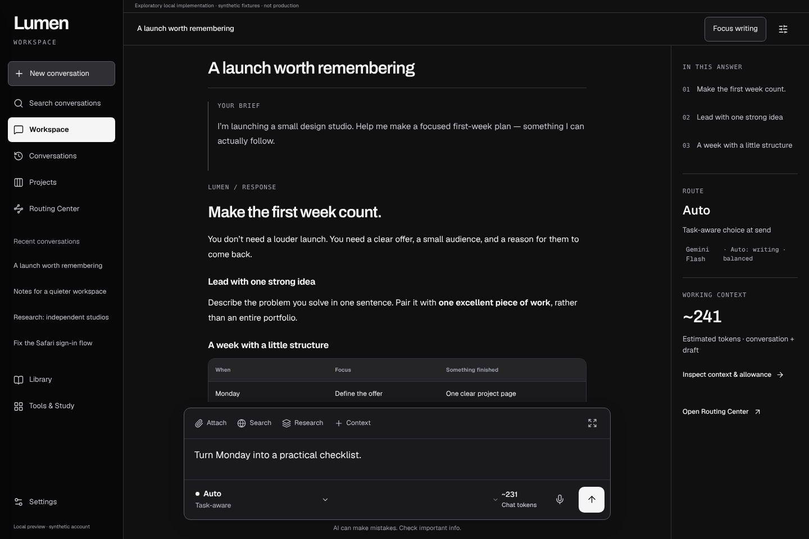 | 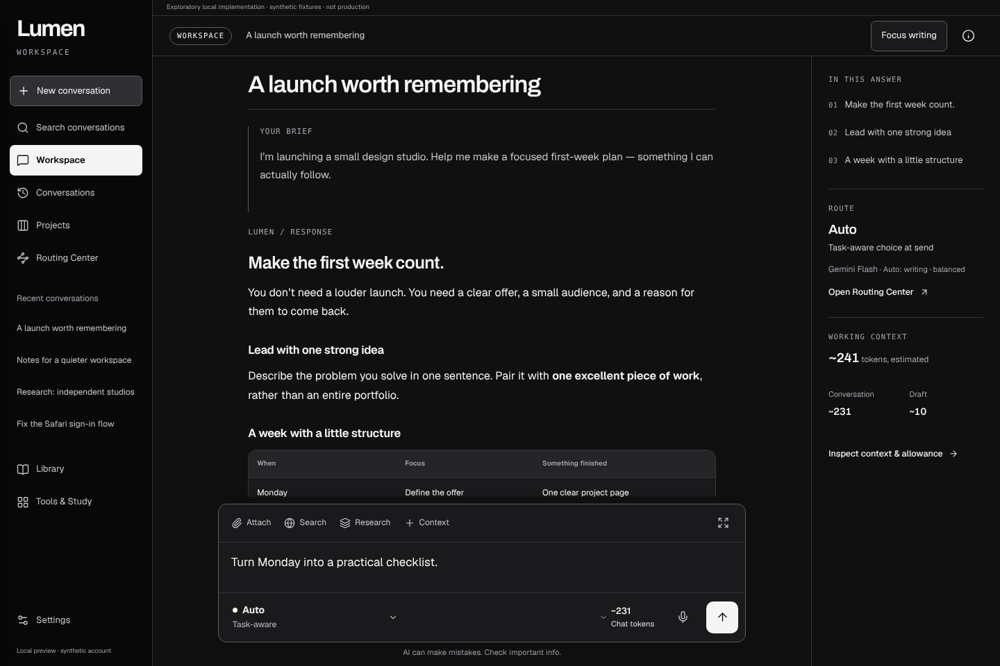 |
| Desktop Focus 1440×960 | 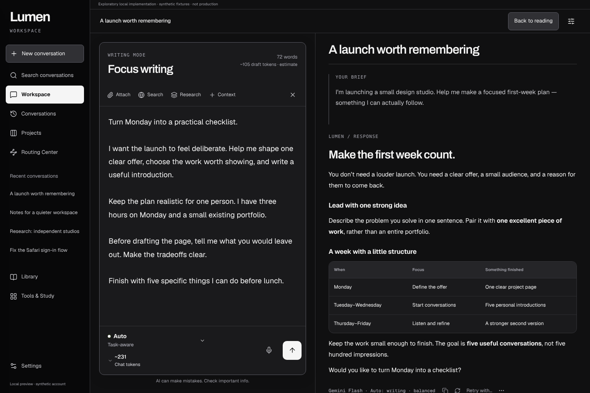 | 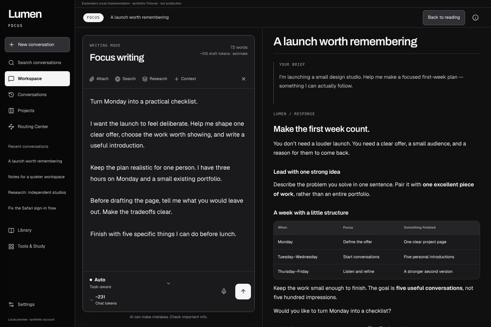 |
| Phone Workspace 390×844 | 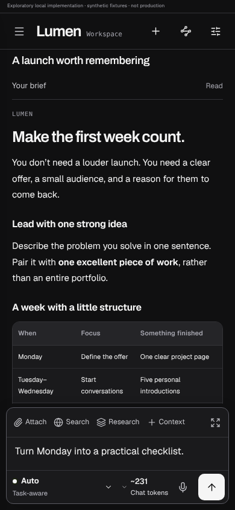 |  |
| Phone Focus 390×844 | 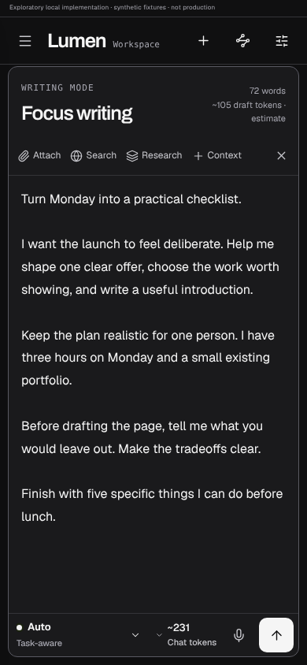 | 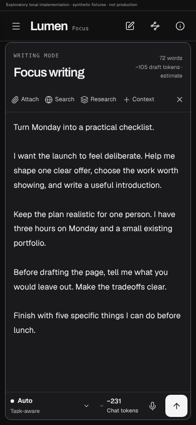 |
| Narrow 320×844 | 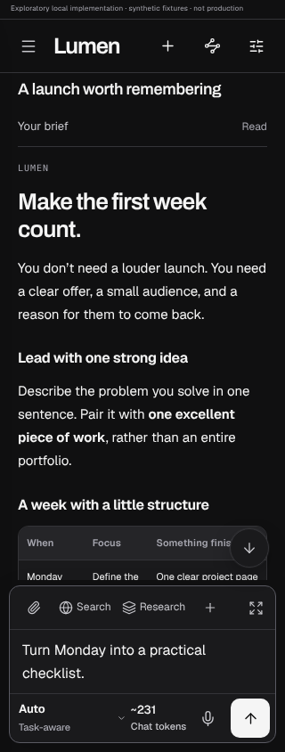 | 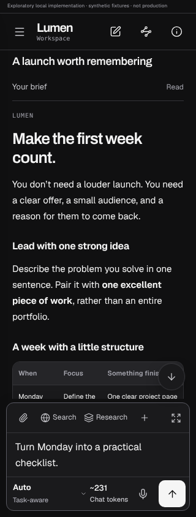 |
| Short phone 390×480 | 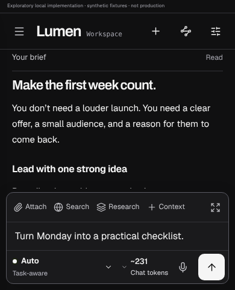 | 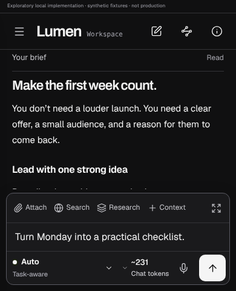 |
| Usage panel 390×844 | 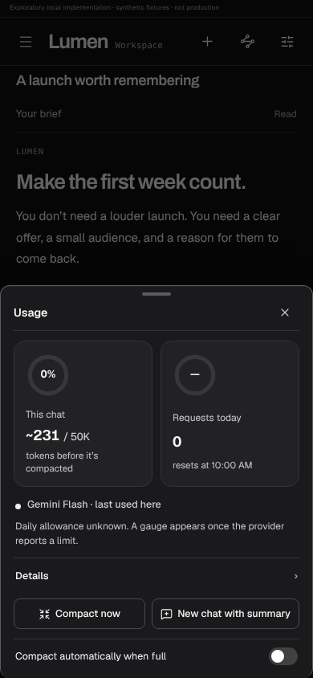 | 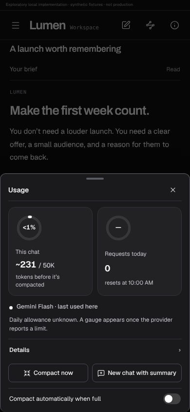 |

Hashes and sources are in [quality-pass/images.json](quality-pass/images.json). Raw output is outside Git in `/home/user/.lumen-verification/gate1-quality-2026-10-21/`.

## Verification

All on a frozen localhost Vite server, port 5195 (`hmr:false, watch:null`), restarted after every source edit. Synthetic fixtures; external traffic is denied.

- **Consolidated matrix:** Chromium 1440×960, 390×844, 320×844, 390×480 and 320×480 all pass. That's 89 WCAG-tagged axe state scans with 0 violations, 0 page errors and 0 document overflow, and exactly one intercepted synthetic Send/Stop per case (0 real provider calls).
- **Retained flagship baseline:** Chromium Index/Studio at 1440×960 and 390×844, Index 320×480 and Studio 390×480 all pass. That's 106 axe states with 0 violations. Assertions are unchanged.
- **First-screen phone reading:** identical before and after.
  - 390×844: first paragraph y256.4–335.1, composer top 668, height 176.
  - 320×844: paragraph y287.6–366.3, composer top 651, height 193.
  - 390×480: paragraph y165.6–244.4, composer top 312, height 168.
  - 320×480: composer top 287, height 193 (≤42%).
- **New harness assertions** (`consolidation-check.cjs`; existing assertions untouched):
  1. Reading names the Workspace mode.
  2. Expanded writing names the Focus mode.
  3. Every visible top-bar button fits inside the viewport, and on phones keeps a 44px target.
  4. The chat meter's label is "<1%", and its `aria-valuetext` starts "Less than 1% used".
  5. The composer chip text never shows a rounded "0%".
- **Red/green:** against the unchanged `41bae00` source, the new harness fails at 390 (mode stays "Workspace" in Focus) and at 1440 (no mode label). With the mode checks removed, it fails on the missing honest usage label. All pass on the new source.
- **Other checks:** `usage-share.test.mjs` passes. Proof `tsc` passes. Repository `npm test` (typecheck plus all unit tests) passes. The production `vite build` passes with the existing ineffective `sync.ts` dynamic-import warning.

**Not run (WebKit and the review rebuild were later completed in [FINAL_VERIFICATION.md](FINAL_VERIFICATION.md)):**
- **Linux WebKit:** it isn't installed in this environment, and its download is blocked by the network policy. The WebKit halves of the matrix, including Studio 320×844 WebKit, still need a run.
- **The strict premium static audit:** its tool isn't in this repository or environment. The 22 pre-existing findings recorded earlier are not re-verified.
- **The portable offline review HTML:** not rebuilt. Its builder expects the full Chromium+WebKit report set, so the curated pairs above are the review artifact for this pass.

Simulated viewports, insets and the 480px writing resize are not physical-iPhone verification.

## Remaining defects and limits

- **Brief spacing:** the desktop "Your brief" block keeps about 40px of space under its text. That space is reserved for its own hover actions (copy/edit). It's canonical behaviour, so it was not removed.
- **Rail rendering:** the RouteWhy line and outline numbers are restyled by proof CSS. The rail is still a proof portal, not a canonical component.
- **Phone toolbar icons:** understandable, but still icon-only, which is a deliberate no-new-chrome trade-off. A physical-device read of the compose/route/ⓘ icons is pending.
- **Typography, colour and motion** remain provisional. No light/black-theme, 200% zoom, localization, streaming or long-history pass was done in this slice.
- **Usage fix location:** it lives in a preview overlay. Production `CompactNote.tsx` still rounds until an approved migration.

## Readiness

The pass is ready for **owner review of the Chromium evidence**. Before a Gate1 approval request, it needs a WebKit run of the same matrix and a physical-iPhone check of the toolbar icons, Focus and keyboard. Progress stays **18.5% (Medium confidence)**; this refines partial B02.1/B02.2 and earns no B02.3/B03/B04 credit. Stop here.
