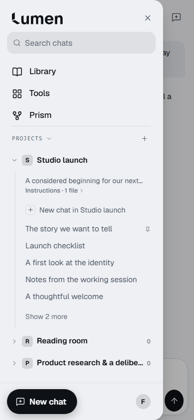
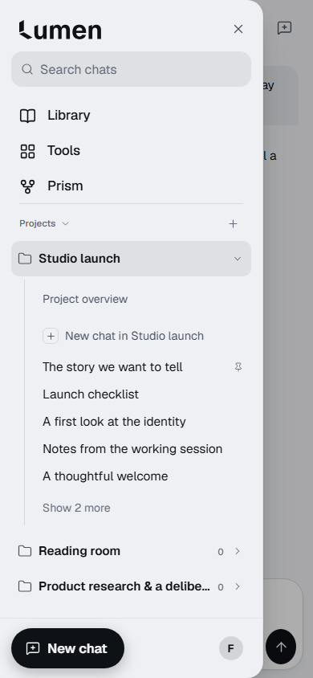
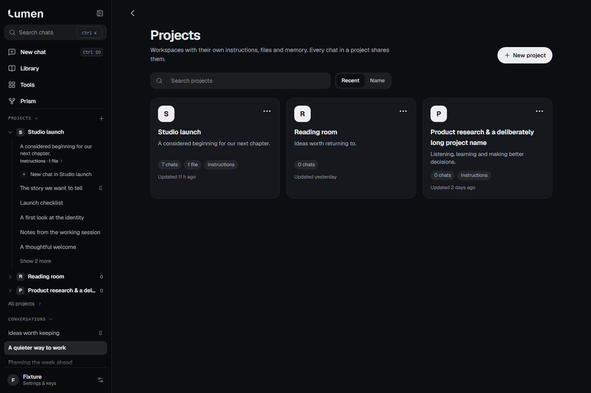
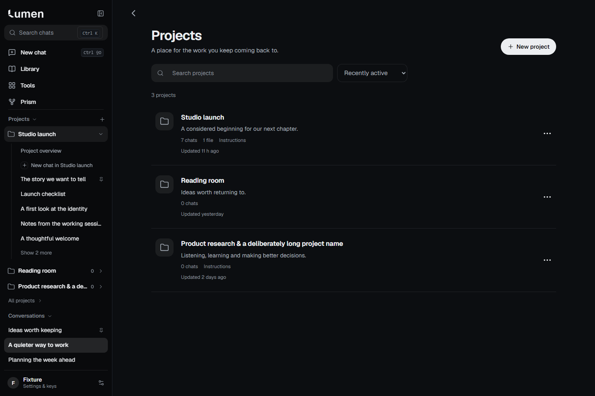

# Conversations & Projects — planner review

Owner clarified **Conversations & Projects first** on2026-10-26; Tools Slice2 remains deferred. This is a draft UI checkpoint, not design acceptance or release. Main/released base is `1e93777767c632dcc3f37faf8f831f583795ad4e` (Library PR58). Implementation source: `e4355acea314ff72ac870f05b73442759ed342e8`. Later delivery documentation changes do not change the captured application source.

## What changed

- Recognizable folder icons, trailing disclosure, sentence-case headings, consistent conversation rhythm and a compact Project overview entry replace competing monograms and repeated metadata. The unified tree, pins, recent order, Draft marker, keyboard controls, contextual menus and global/project New chat distinction remain canonical.
- Projects becomes a responsive list with readable descriptions, plain context counts and contextual actions. Search has a44px clear action, result feedback and sorting on both phone and desktop. Existing query/sort/history owners remain.
- Project overview gets a full-width composer, clearer chat hierarchy and one quieter context panel for instructions, memory and files. Actions have44px minimum targets. Existing file, memory, conversation and send implementations are reused.

## Real-application comparison

[Side-by-side review](review.html) contains28 paired captures and4 additional context/menu captures (32 PNGs total). Open locally for the image comparison viewer. All files are actual app screenshots, not mockups; no reference-product assets are copied.

| Released | Candidate |
|---|---|
|  |  |
|  |  |

The comparison covers390/1440px Light/Dark for tree, collection and overview, plus320px Dark collection and430px Light tree. Additional phone context and chat-menu states are included. The full engine matrices and additional captures are generated by the committed test and retained by CI.

## Provenance and verification

- Fixture SHA256: `6d0d75b15670816c62a07ef77ea810f5b7c267d5b0ae649924e22a144541fd20`. Both phases/engines use the same saved projects/chats. Local default clock may change relative-time labels; no pixel equality is claimed.
- Baseline Canvas build: released1e93777, captured from `dist-test` on5191. Candidate Canvas build: exact application sourcee4355ac, `dist-canvas` on5192. Both are loopback-only. [Baseline Chromium](before/chromium-results.json), [baseline WebKit](before/webkit-results.json), [candidate Chromium](after/chromium-results.json), [candidate WebKit](after/webkit-results.json).
- New presentation suite: Chromium8/8 and Windows WebKit8/8 at320/390/430/1440px, Light/Dark;60 axe scans total; geometry, discovery/search reset/sort, folder keyboard, archived results, draft return, project Exit, menu focus and zero inference requests. External traffic blocked; startup model catalogue locally fulfilled with synthetic data. Capture helper retains menu focus and moves pointer off ordinary controls.
- RED evidence: baseline failed recognizable-folder assertion; review regression failed undersized clear-control assertion. After fixes, full Chromium/WebKit matrices pass. Clear geometry asserts44px target, viewport containment and input separation while populated.
- `npm.cmd test`: typecheck and all100 unit files passed. Ordinary and Canvas production builds passed. CP01 graph isolation passed (2575 modules,174 hashes,20 negative controls). QA01 graph/output/isolation passed8 checks using the existing CI policy `QA01_ALLOW_NO_BASELINE=1`.
- Ordinary byte identity is **not claimed**: optional comparison against a separately archived release build differed in generated JS chunk hashes. Presentation changes are Canvas-scoped; canonical ordinary behavior and graph checks remain. No test, assertion, budget, protected allowlist or required CI job was removed.
- Existing project-form regressions:3/3 viewports per engine. Feature Exit with original drafts, attachments, delayed IO and document guards:4/4 per engine. Existing navigation journeys:4/4 per engine. Chromium multi-screen state matrix3/3, including large text/solid fallback/gestures/history. An initial concurrent Windows WebKit state run failed Library search restoration; follow-up isolated results and gated focus limits are recorded below rather than hidden.
- Gated synthetic build from clean commite4355ac:178 files,2596 audited modules; immutable manifest SHA256 `2dfe903de40b7ca4c11842cab170fde52178718a1dd7fe3175e23c196ef23153`. Chromium CP03 shell3/3; CP05 screens4/4 per engine (9desktop/10phone checks each). Selector changes only replace old project descriptions with project-scoped Project overview; behavior assertions retained.

## Performance and limits

Final measured ordinary/Canvas startup:467.6/480.8KB JS gz,60.4/76.2KB CSS gz. Canvas growth13.1KB JS and15.8KB CSS; lazy Prism7.7KB; approximate Canvas CSS source20.5KB. All unchanged caps pass (13.5/16/9/21KB). Baseline Canvas CSS growth was about15.3KB; this checkpoint adds about0.5KB gz of startup styling. No measured speed improvement claim.

Physical iPhone, installed PWA, VoiceOver and real provider behavior remain unverified. Local tests use Windows Playwright WebKit; required exact-head CI uses Linux WebKit. Windows CP03 twice timed out restoring focus from collapsed-rail Library at `private-qa-canvas-shell.mjs:293`; the same assertion failed on a clean archived/rebuilt released1e93777 QA build (manifest `9300c5f22b04e9c37e702bc2d00037c175532e6fa41ce9fbe3e48feb9c782f48`). This is an inherited Windows limitation, not counted as a pass. Windows Library search restoration failed at390px in `iphone-navigation-states.cjs:27` in concurrent and isolated source runs; baseline390 passed and an instrumented source390 run passed with correct history IDs1→2→1/query. This timing-sensitive local regression check is unresolved, not silently retried to green; the complete WebKit state matrix is not claimed. No navigation runtime owner was changed to mask it.

Exact delivery HEAD, CI URL/result and final planner status live in the draft PR and `docs/lumen-live-context` checkpoint to avoid self-referential documentation commits. No deployment, provider inference, account/transport/storage/billing changes or spending occurred. Overall completion percentage is undefined for the seven-phase program. **STOP for planner review.**
