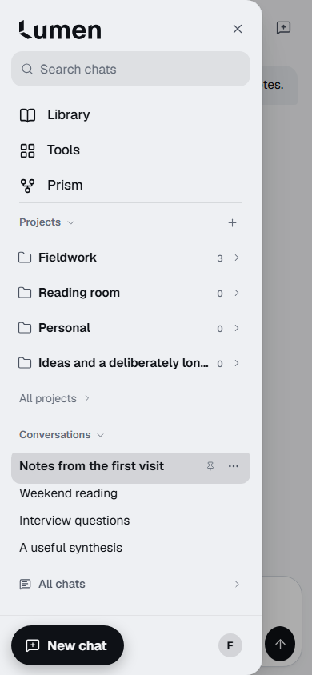
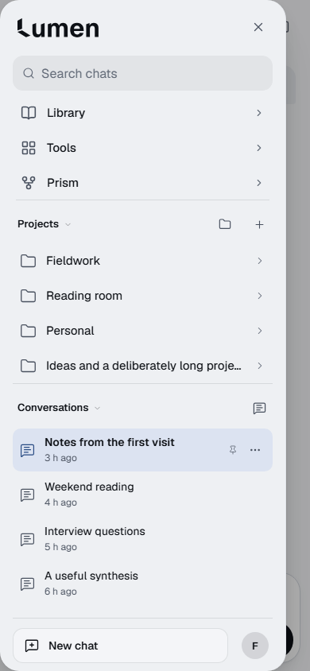
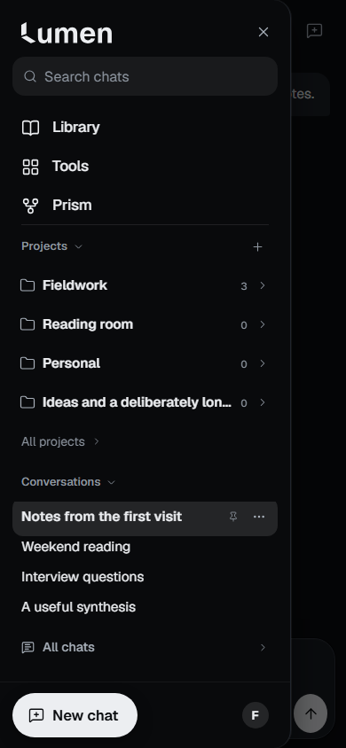
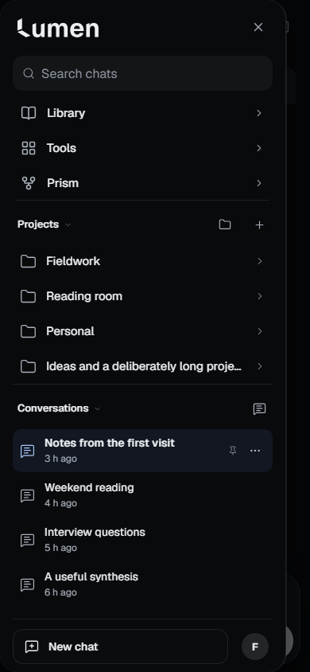

# Conversations & Projects — approved composition expanded

The owner approved the actual390px Light drawer and explicitly asked to keep that direction. The expanded implementation tightens Search-to-navigation spacing, gives Projects/Conversations a consistent heading rhythm, softens Dark selection, and retains clean two-line conversation rows with long titles, pins, drafts and menus. Desktop uses the same composition at a denser scale. Empty Projects has one useful New project action. All projects and All chats remain canonical section actions; global New chat and Settings form a quiet footer.

Application source: `eec2ad2ec69760525aebb36a7809f7ac2e38501c`. Before: released main `828a05c79debbdeba606e441bf7bbc57f811ca38`. Approved first gate: `f4dfdf41a4c1e94aefcea50c7fb256013bc7cf09`. Later evidence/test-only commits preserve application file hashes recorded in [provenance.json](provenance.json). [Draft PR60](https://github.com/Seifonyx/Lumen/pull/60) records the exact final delivery HEAD and exact-head CI; final remote CI/live checkpoint readback supersedes this immutable candidate evidence. No merge or deployment.

## Actual screenshot gallery

[Open the local/offline comparison gallery](index.html). The repository includes **200 actual, unmodified application PNGs**:64 matching baseline layouts and136 expanded layouts/interaction captures across Chromium and WebKit. All data is fictional and seeded into the real store. The owner's private images are not republished. These are browser captures, not generated mockups.

|390px populated|Before|After|
|---|---|---|
|Light|||
|Dark|||

|Additional review states|Actual captures|
|---|---|
|320px phone|[Empty](after/chromium/320-light-empty.png), [populated top](after/chromium/320-light-populated.png), [selected/focus](after/chromium/320-dark-populated-focus.png), [bounded menu](after/chromium/320-dark-populated-menu.png)|
|430px phone|[Dense](after/chromium/430-light-dense.png), [scrolled](after/chromium/430-light-dense-scrolled.png), [larger text](after/chromium/430-light-dense-large-text.png)|
|Expanded project|[390px Dark](after/chromium/390-dark-expanded.png), [desktop Light](after/chromium/1440-light-expanded.png)|
|Desktop|[Light](after/chromium/1440-light-populated.png), [Dark](after/chromium/1440-dark-populated.png), [hover](after/chromium/1440-light-populated-hover.png), [collapsed](after/chromium/1440-dark-collapsed.png)|
|Accessibility|[Visible focus](after/chromium/390-dark-populated-focus.png), [forced colors](after/chromium/390-dark-populated-forced-colors.png)|

At320px and in expanded/dense lists, the tree scrolls independently while Search and the creation/account footer remain available. Captures include both the top composition and selected/scrolled content. Relative times use the existing real formatter; timestamps advance between baseline and candidate capture sessions.

## Verification and scope

- New `tests/e2e/drawer-reference.cjs`:32 layout cases per engine (320/390/430/1440 × Light/Dark × empty/populated/dense/expanded), plus hover, focus, native menus, collapsed desktop, larger type and forced colors. Geometry checks retain distinct44px phone controls/actions; no duplicate visible chat entries or horizontal overflow. Axe scans cover every layout and hover, plus larger type. Search finds archived chats; section/folder keyboard behavior, menu End/Escape/focus and unsent-draft return remain canonical. Zero provider inference requests and page errors are asserted.
- Full typecheck/unit suite and both production builds pass locally. Canonical Conversations & Projects8 cases/engine, whole-feature Exit4 widths/engine, project forms3 widths/engine, phone glass navigation8 cases/engine, navigation journeys4 widths/engine, state/gesture/keyboard/refresh journeys3 phone sizes/engine, chat menus6 cases/engine and scripted project/document edge-back pass. The unchanged selected-row/segmented-control/motion suite passes. Drafts, attachments, pinning/move/rename/archive, project routing and account isolation retain their existing owners and regression coverage.
- Chromium CP03 shell12 checks at1440/390/320 and CP05 screens at all4 widths in Light/Dark pass. CP05 also passes in Windows WebKit. Clean committed QA build audits the same production presentation module; graph/output isolation and all9 QA01 checks pass with negative controls intact. The exact pure formatter extraction is listed as a reviewed presentation file, without changing network/permission protections.
- Independent whole-branch review found secondary-action sizing and combined accessible descriptions; both fixed. Screenshot review found clipped menus at320px; canonical menus now use the native top layer within their original DOM/focus scope. A follow-up caught animation measurement: placement now uses untransformed dimensions. Normal-motion phone menus, expanded project choices, rapid keyboard reopening and focus return pass in both engines; reviewer verified the fixes. Inactive ellipsis taps also retain focus through WebKit pointer-down; the inherited issue was reproduced on released main before repair. Feature detection preserves canonical inline menus if the native top layer is unavailable; a local missing-API simulation opens/closes without page errors.
- CI initially exposed the missing exact-file audit entry, then a focus check that used programmatic focus. The entry now names only the unchanged pure formatter; focus is verified after genuine Shift+Tab/Tab. No assertions, budget caps or negative controls were removed. Existing pin tests now resolve all description IDs, and End checks the last actual conversation because All chats is a section action. The full CI822a3b4 run then passed19/23 jobs and exposed three canonical contracts: semibold current rows, empty-workspace All projects access, and rapid keyboard menu reopening. These were repaired in implementation; existing more-motion, iphone-edge-back and six-case chat-menu suites pass unchanged. The expanded matrix also asserts empty destination access and inactive-menu behavior.

## Performance

Same machine/dependencies, gzip, released828a05c versus application candidate. These are bundle measurements, not a measured-speed claim; ordinary rollback output is not claimed byte-identical.

|Metric|Before|After|Unchanged cap|
|---|---:|---:|---:|
|Canvas startup JS|480.8KB|481.2KB|growth below|
|Canvas minus ordinary startup JS|13.1KB|13.1KB|13.5KB|
|Canvas startup CSS|76.2KB|75.8KB|growth below|
|Canvas minus ordinary startup CSS|15.8KB|15.4KB|16KB|
|Lazy Routing Center|7.7KB|7.7KB|9KB|
|Scoped CSS source audit|20.5KB|20.2KB|21KB|

## Limits and review gate

Physical iPhone/Safari/PWA, VoiceOver, real IME and device Dynamic Type remain unverified. Browser automation validates DOM descriptions, keyboard focus, axe, touch geometry and synthetic gestures; it does not certify physical-device accessibility. Local Windows WebKit CP03 still hits the previously documented collapsed-rail Library focus-return timeout; Linux exact-head CI owns the required cross-engine certification. Any local run interrupted by rebuilding its served asset directory is discarded; final captures use a stable committed build.

**STOP for owner design review.** Expanded visual acceptance remains the owner's decision. No merge, deployment, provider inference, new service/schema/infrastructure, spending or Tools Slice2 work is authorized. Overall seven-phase completion percentage is not defined.

## Full matching layout matrix

|Width|Theme|State|Chromium before / after|WebKit before / after|
|---|---|---|---|---|
|320|light|empty|[before](before/chromium/320-light-empty.png) · [after](after/chromium/320-light-empty.png)|[before](before/webkit/320-light-empty.png) · [after](after/webkit/320-light-empty.png)|
|320|light|populated|[before](before/chromium/320-light-populated.png) · [after](after/chromium/320-light-populated.png)|[before](before/webkit/320-light-populated.png) · [after](after/webkit/320-light-populated.png)|
|320|light|dense|[before](before/chromium/320-light-dense.png) · [after](after/chromium/320-light-dense.png)|[before](before/webkit/320-light-dense.png) · [after](after/webkit/320-light-dense.png)|
|320|light|expanded|[before](before/chromium/320-light-expanded.png) · [after](after/chromium/320-light-expanded.png)|[before](before/webkit/320-light-expanded.png) · [after](after/webkit/320-light-expanded.png)|
|320|dark|empty|[before](before/chromium/320-dark-empty.png) · [after](after/chromium/320-dark-empty.png)|[before](before/webkit/320-dark-empty.png) · [after](after/webkit/320-dark-empty.png)|
|320|dark|populated|[before](before/chromium/320-dark-populated.png) · [after](after/chromium/320-dark-populated.png)|[before](before/webkit/320-dark-populated.png) · [after](after/webkit/320-dark-populated.png)|
|320|dark|dense|[before](before/chromium/320-dark-dense.png) · [after](after/chromium/320-dark-dense.png)|[before](before/webkit/320-dark-dense.png) · [after](after/webkit/320-dark-dense.png)|
|320|dark|expanded|[before](before/chromium/320-dark-expanded.png) · [after](after/chromium/320-dark-expanded.png)|[before](before/webkit/320-dark-expanded.png) · [after](after/webkit/320-dark-expanded.png)|
|390|light|empty|[before](before/chromium/390-light-empty.png) · [after](after/chromium/390-light-empty.png)|[before](before/webkit/390-light-empty.png) · [after](after/webkit/390-light-empty.png)|
|390|light|populated|[before](before/chromium/390-light-populated.png) · [after](after/chromium/390-light-populated.png)|[before](before/webkit/390-light-populated.png) · [after](after/webkit/390-light-populated.png)|
|390|light|dense|[before](before/chromium/390-light-dense.png) · [after](after/chromium/390-light-dense.png)|[before](before/webkit/390-light-dense.png) · [after](after/webkit/390-light-dense.png)|
|390|light|expanded|[before](before/chromium/390-light-expanded.png) · [after](after/chromium/390-light-expanded.png)|[before](before/webkit/390-light-expanded.png) · [after](after/webkit/390-light-expanded.png)|
|390|dark|empty|[before](before/chromium/390-dark-empty.png) · [after](after/chromium/390-dark-empty.png)|[before](before/webkit/390-dark-empty.png) · [after](after/webkit/390-dark-empty.png)|
|390|dark|populated|[before](before/chromium/390-dark-populated.png) · [after](after/chromium/390-dark-populated.png)|[before](before/webkit/390-dark-populated.png) · [after](after/webkit/390-dark-populated.png)|
|390|dark|dense|[before](before/chromium/390-dark-dense.png) · [after](after/chromium/390-dark-dense.png)|[before](before/webkit/390-dark-dense.png) · [after](after/webkit/390-dark-dense.png)|
|390|dark|expanded|[before](before/chromium/390-dark-expanded.png) · [after](after/chromium/390-dark-expanded.png)|[before](before/webkit/390-dark-expanded.png) · [after](after/webkit/390-dark-expanded.png)|
|430|light|empty|[before](before/chromium/430-light-empty.png) · [after](after/chromium/430-light-empty.png)|[before](before/webkit/430-light-empty.png) · [after](after/webkit/430-light-empty.png)|
|430|light|populated|[before](before/chromium/430-light-populated.png) · [after](after/chromium/430-light-populated.png)|[before](before/webkit/430-light-populated.png) · [after](after/webkit/430-light-populated.png)|
|430|light|dense|[before](before/chromium/430-light-dense.png) · [after](after/chromium/430-light-dense.png)|[before](before/webkit/430-light-dense.png) · [after](after/webkit/430-light-dense.png)|
|430|light|expanded|[before](before/chromium/430-light-expanded.png) · [after](after/chromium/430-light-expanded.png)|[before](before/webkit/430-light-expanded.png) · [after](after/webkit/430-light-expanded.png)|
|430|dark|empty|[before](before/chromium/430-dark-empty.png) · [after](after/chromium/430-dark-empty.png)|[before](before/webkit/430-dark-empty.png) · [after](after/webkit/430-dark-empty.png)|
|430|dark|populated|[before](before/chromium/430-dark-populated.png) · [after](after/chromium/430-dark-populated.png)|[before](before/webkit/430-dark-populated.png) · [after](after/webkit/430-dark-populated.png)|
|430|dark|dense|[before](before/chromium/430-dark-dense.png) · [after](after/chromium/430-dark-dense.png)|[before](before/webkit/430-dark-dense.png) · [after](after/webkit/430-dark-dense.png)|
|430|dark|expanded|[before](before/chromium/430-dark-expanded.png) · [after](after/chromium/430-dark-expanded.png)|[before](before/webkit/430-dark-expanded.png) · [after](after/webkit/430-dark-expanded.png)|
|1440|light|empty|[before](before/chromium/1440-light-empty.png) · [after](after/chromium/1440-light-empty.png)|[before](before/webkit/1440-light-empty.png) · [after](after/webkit/1440-light-empty.png)|
|1440|light|populated|[before](before/chromium/1440-light-populated.png) · [after](after/chromium/1440-light-populated.png)|[before](before/webkit/1440-light-populated.png) · [after](after/webkit/1440-light-populated.png)|
|1440|light|dense|[before](before/chromium/1440-light-dense.png) · [after](after/chromium/1440-light-dense.png)|[before](before/webkit/1440-light-dense.png) · [after](after/webkit/1440-light-dense.png)|
|1440|light|expanded|[before](before/chromium/1440-light-expanded.png) · [after](after/chromium/1440-light-expanded.png)|[before](before/webkit/1440-light-expanded.png) · [after](after/webkit/1440-light-expanded.png)|
|1440|dark|empty|[before](before/chromium/1440-dark-empty.png) · [after](after/chromium/1440-dark-empty.png)|[before](before/webkit/1440-dark-empty.png) · [after](after/webkit/1440-dark-empty.png)|
|1440|dark|populated|[before](before/chromium/1440-dark-populated.png) · [after](after/chromium/1440-dark-populated.png)|[before](before/webkit/1440-dark-populated.png) · [after](after/webkit/1440-dark-populated.png)|
|1440|dark|dense|[before](before/chromium/1440-dark-dense.png) · [after](after/chromium/1440-dark-dense.png)|[before](before/webkit/1440-dark-dense.png) · [after](after/webkit/1440-dark-dense.png)|
|1440|dark|expanded|[before](before/chromium/1440-dark-expanded.png) · [after](after/chromium/1440-dark-expanded.png)|[before](before/webkit/1440-dark-expanded.png) · [after](after/webkit/1440-dark-expanded.png)|
