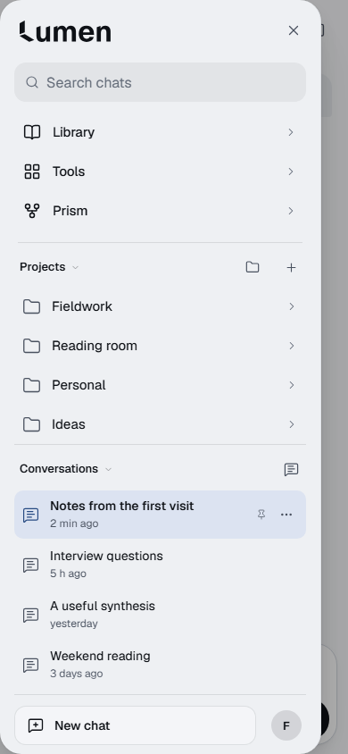

# Owner-reference drawer — first visual approval gate

Actual app capture at **390x844, iPhone width, Light, populated**. Local source checkpoint `f4dfdf41a4c1e94aefcea50c7fb256013bc7cf09`, branch `feat/drawer-composition-pass2`, from released main828a05c. [Focused capture/check results](results.json).

Follows the owner's newer primary reference: flat divided sections, restrained blue selection, outlined folders/chat glyphs, genuine conversation metadata, leading quiet New chat and trailing Settings avatar. Search retains its actual supported scope; project/chat data and canonical list placement are real. Four synthetic projects, four unique general chats and one nested project chat; no copied private screenshot, fake filter, duplicated chat or collapsed-phone design.

Verified for this single checkpoint: successful Canvas build/typecheck; existing navigation and presentation-seam unit checks12/12; axe0 violations;44px visible primary targets; non-overlapping conversation hit areas; original menu/focus and general New chat/draft return; no inference requests. Not a physical iPhone/VoiceOver result.

**STOP for owner visual approval.** Remaining states/themes, desktop refinement, full regressions/budgets/isolation/exact-head CI and new draft PR are pending that approval. No merge or deployment. Prior interrupted experiments/full-state results do not certify this new reference direction.
