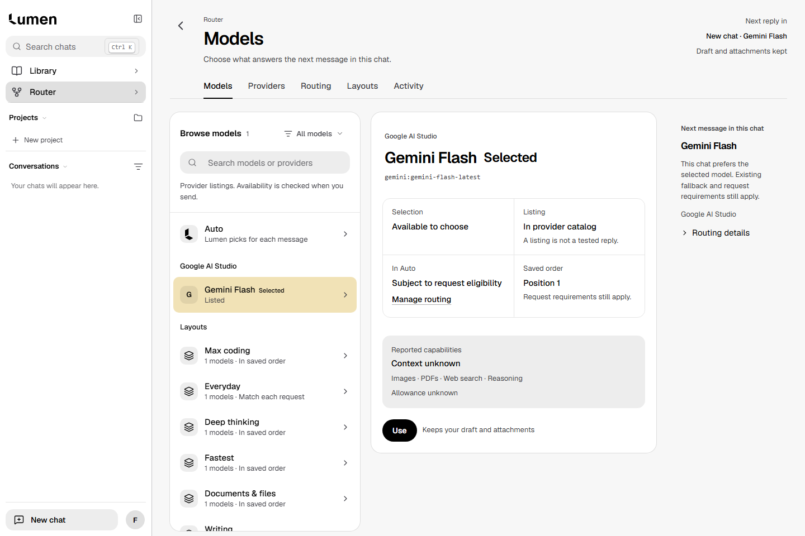
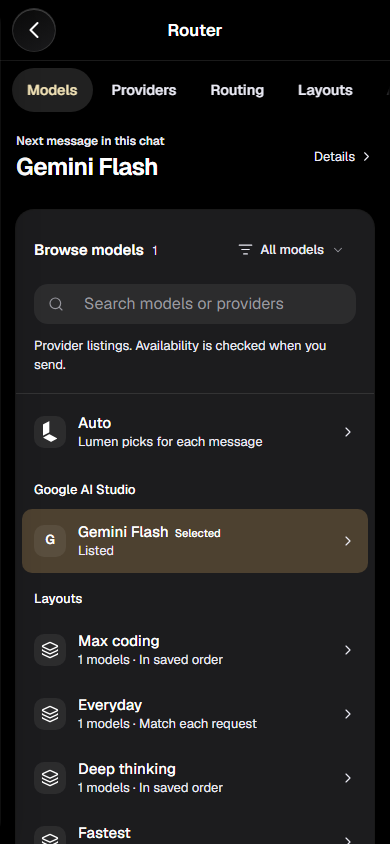

# Router implementation review — release blocked

Continuation: [CSS cleanup measurements and fresh screenshot parity](../CSS_BUDGET.md). Source33.303→33.003KB;22 new before/after captures are pixel-identical. The original checkpoint below remains historical evidence; the29.5KB release gate still fails.

Actual synthetic Chromium screenshots from application source `f546e98ee004959b0cfab64b9d599ec2857a3636`. No private design package, real accounts or provider inference.22 captures cover all five sections at1440/390 in Light/Dark, plus Models at1024/320. These are visual evidence, not a complete browser/accessibility certification. [Capture results](results.json). Reproduce with `node tests/e2e/helpers/router-review.cjs` against a loopback Canvas server.

| Section | Desktop Light / Dark | Phone Light / Dark |
|---|---|---|
|Models|[Light](1440-light-models.png) · [Dark](1440-dark-models.png)|[Light](390-light-models.png) · [Dark](390-dark-models.png)|
|Providers|[Light](1440-light-providers.png) · [Dark](1440-dark-providers.png)|[Light](390-light-providers.png) · [Dark](390-dark-providers.png)|
|Routing|[Light](1440-light-routing.png) · [Dark](1440-dark-routing.png)|[Light](390-light-routing.png) · [Dark](390-dark-routing.png)|
|Layouts|[Light](1440-light-layouts.png) · [Dark](1440-dark-layouts.png)|[Light](390-light-layouts.png) · [Dark](390-dark-layouts.png)|
|Activity|[Light](1440-light-activity.png) · [Dark](1440-dark-activity.png)|[Light](390-light-activity.png) · [Dark](390-dark-activity.png)|

Release gate: required `npm run test:affected -- --run` passes type/full units and both builds, then fails complete CSS source audit33.3KB against29.5KB. Startup JS15.1/15.5KB, CSS19.4/20KB and lazy Router8.3/9KB pass. Caps unchanged; new stylesheet included in accounting. Affected browser/contracts do not run past this failure. Scoped agent runs and remaining replay gaps are listed in [implementation record](../IMPLEMENTATION.md). No merge/deployment and no green exact-head CI claimed. Physical iPhone/VoiceOver unverified.
